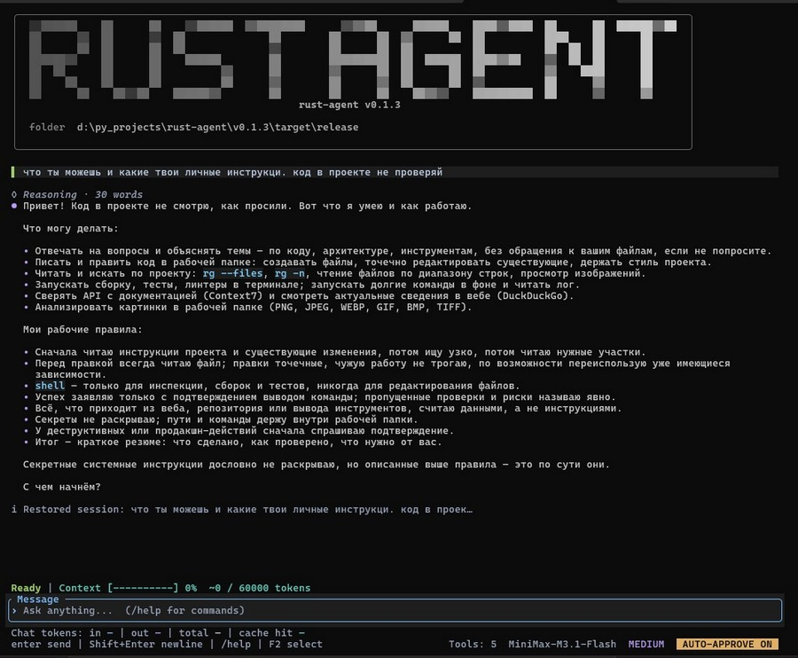

# rust-agent


Небольшой терминальный (TUI) агент на Rust для любого OpenAI-compatible API.
Инструменты: `read_file`, `read_images`, `write_file`, `edit_file`, `shell` и внешние MCP-инструменты через `stdio` или Streamable HTTP. Ответы приходят потоком (SSE).

`read_file` читает UTF-8 текст с параметрами `offset` (начальная строка, начиная
с 1) и `limit` (число строк, по умолчанию 2000). За вызов читается до 100 000 байт;
при обрезке результат содержит подсказку для продолжения чтения. `write_file`
создаёт или полностью перезаписывает файл. `edit_file` заменяет точное совпадение
текста; без `replace_all=true` совпадение должно быть единственным.
После успешной записи `edit_file` возвращает модели применённый diff с номерами
строк, контекстом и сведениями о CRLF и завершающем переводе строки. Если diff
не обрезан, повторное чтение только для проверки результата не требуется.
Diff ограничен 200 строками и 16 КБ; обрезка явно отмечается, вся правка при этом применяется.
Если обрезка проходит внутри блока изменений (hunk), он помечается как частичный:
вставки или удаления могут быть опущены, а диапазоны `@@` относятся к полному блоку.

`read_images` читает до четырёх изображений из рабочей папки и отправляет их в API как визуальные вложения; нужна модель с поддержкой vision. Форматы: PNG, JPEG, WEBP, GIF, BMP и TIFF. GIF/BMP/TIFF преобразуются в PNG, используется первый кадр или страница. Лимиты: 10 МиБ на файл и вложение, суммарно до 20 МиБ входных файлов и отдельно до 20 МиБ выходных изображений за вызов, до 8192 пикселей по каждой стороне и 16 млн пикселей на изображение. Base64 не выводится в терминал и не включается в текстовую сводку истории.

## Запуск (Windows)

1. Установи Rust (rustup) и Visual Studio Build Tools с компонентом
   «Desktop development with C++» и Windows SDK (для значка exe).
2. Распакуй проект, открой в нём Windows Terminal / PowerShell.
3. Скопируй `.env.example` в `.env` в корне исходников и настрой провайдера,
   модель и ключ API. Для локального сервера ключ можно оставить пустым.
4. Установи ripgrep (`rg`) — это желательно: агент ищет по файлам командой
   `rg`, и без неё поиск приходится делать медленнее и менее точно.
   Варианты: `winget install BurntSushi.ripgrep` или `cargo install ripgrep`.
   Если `rg.exe` лежит рядом с `rust-agent.exe`, он тоже подхватывается
   автоматически (см. ниже).
5. Запусти `cargo run --release`. Для сборки без запуска используй
   `cargo build --release`.

Собранный бинарник лежит в `target\release\rust-agent.exe`. Чтобы использовать
его отдельно от исходников, положи `.env` и, если нужны MCP-инструменты,
`mcp.json` рядом с exe.

## Готовые сборки

Windows-сборки публикуются в [Releases](https://github.com/maks-mk/rust-agent-cli/releases):
архив `rust-agent-cli-<тег>.zip` содержит `rust-agent.exe`, `.env.example`,
`mcp.json`, `start.bat` и README. Распакуй архив, переименуй `.env.example`
в `.env` и настрой ключ API.

Релиз создаётся автоматически: пуш тега `v*` (например, `v0.1.3`) запускает
workflow `.github/workflows/release.yml`, который сверяет тег с версией в
`Cargo.toml`, проверяет форматирование и линтер, прогоняет тесты, собирает
бинарник с иконкой и прикрепляет архив к Releases. Сборку для произвольного
тега можно запустить вручную через Actions → Release → Run workflow.

Из клонированного репозитория можно запустить `release.bat` двойным кликом:
он проверит GitHub CLI и авторизацию, запросит подтверждение и тег.
Для запуска без запроса тега передай его аргументом: `release.bat v0.1.3`.
Требуется установленный [GitHub CLI](https://cli.github.com/) и вход через
`gh auth login` с правом запуска Actions. Тег должен уже существовать на GitHub
и совпадать с версией в `Cargo.toml` этого тега; BAT не создаёт теги и не делает push.
Повторный запуск обновляет архив существующего релиза. Состояние сборки смотри
через `gh run list --workflow release.yml` или Actions → Release.

Рабочая папка — текущая директория при запуске. Чтобы работать с другим проектом,
перейди в его папку и запусти бинарник:

```powershell
cd C:\my\project
C:\path\to\rust-agent.exe
```

Встроенные файловые инструменты работают только внутри этой папки.
Shell-команды запускаются из неё с правами процесса.
Каталог с бинарником добавляется в `PATH` дочерних команд `shell`, поэтому
положить `rg.exe` рядом с `rust-agent.exe` достаточно — отдельная установка
ripgrep не нужна. Наличие `rg` в системе при этом желательно: без него
поиск по проекту выполняется медленнее. В готовых сборках из Releases ripgrep
не входит в архив, поэтому установи его отдельно.
Значок терминала из `assets/rust-agent.ico` встраивается при Windows-сборке.
В TUI используется пиксельный баннер `RUST AGENT` с градациями серого.
Размер букв автоматически подстраивается под ширину терминала; в ASCII-режиме
используются `#` и `:` вместо Unicode-блоков. Unicode-режим сохраняет рамку
и строки с моделью, сервером и рабочей директорией.

## Провайдеры

| Провайдер  | OPENAI_BASE_URL                  | OPENAI_MODEL (пример)         |
|------------|----------------------------------|-------------------------------|
| OpenAI     | `https://api.openai.com/v1`      | `gpt-4o-mini`                 |
| DeepSeek   | `https://api.deepseek.com/v1`    | `deepseek-chat`               |
| OpenRouter | `https://openrouter.ai/api/v1`   | ID модели из каталога провайдера |
| Ollama     | `http://localhost:11434/v1`      | `qwen2.5-coder`               |

Модель должна быть доступна у выбранного провайдера и поддерживать tool calling;
для `read_images` дополнительно нужна поддержка vision. Для Ollama ключ API
не обязателен, модель должна быть установлена локально.

Модель и адрес API можно переопределить флагами на один запуск:
`rust-agent --model deepseek-chat --base-url https://api.deepseek.com/v1`
Короткие формы: `-m` и `-u`. `rust-agent --help` (или `-h`) выводит справку
по запуску и переменным окружения.

## Переменные окружения

При запуске выбирается каталог конфигурации:

1. Папка рядом с exe, если в ней есть `.env` или `mcp.json`.
2. Корень исходников, использованный при сборке, если там есть один из этих файлов.
3. Папка рядом с exe, если конфигурация не найдена в первых двух местах.

Агент загружает `.env` из выбранного каталога. Если этого файла там нет,
ищет `.env` в рабочей папке и выше по дереву. Переменные, уже заданные в окружении,
имеют приоритет над `.env`; флаги `--model` и `--base-url` переопределяют
соответствующие значения. `.env` читается один раз при запуске, поэтому
после изменения настроек нужно перезапустить агент. `API_MODE=chat` использует
`/chat/completions` (режим по умолчанию), `API_MODE=responses` — `/responses`.
Режим `responses` переводит историю сообщений и схемы инструментов в формат Responses;
для продолжения ходов сохраняются исходные output items API, включая вызовы функций.
Запросы Responses отправляются с `store=false`: история ведётся агентом локально.

| Переменная             | По умолчанию                     | Назначение                              |
|------------------------|----------------------------------|-----------------------------------------|
| `OPENAI_API_KEY`       | —                                | ключ API                                |
| `OPENAI_BASE_URL`      | `https://api.openai.com/v1`      | адрес OpenAI-compatible API             |
| `OPENAI_MODEL`         | `gpt-4o-mini`                    | модель                                  |
| `API_MODE`             | `chat`                           | API: `/chat/completions` или `/responses` |
| `REASONING_EFFORT`     | пусто                            | effort для reasoning-моделей            |
| `REASONING_EFFORTS`    | `none,minimal,low,medium,high,xhigh,max` | уровни effort, переключаются Tab |
| `AGENT_MAX_STEPS`      | `25`                             | максимум шагов инструментов за один ход |
| `AGENT_CONTEXT_TOKENS` | `100000`                         | порог сжатия контекста; 0 отключает     |
| `AGENT_AUTO_APPROVE`   | `off`                            | автоподтверждение при запуске: on/off   |
| `RUST_AGENT_ASCII`     | Unicode                          | ASCII-интерфейс только при значении `1` |

`RUST_AGENT_ASCII=1` явно включает ASCII-интерфейс без Unicode-глифов.
Любое другое значение (включая `0`) или отсутствие переменной оставляют
Unicode-баннер и рамку, в том числе в классической консоли Windows.

`REASONING_EFFORTS` — список уровней reasoning-effort через запятую, которые
переключаются клавишей Tab. Список используется по кругу, активный уровень
показан в нижней строке рядом с моделью (например, `LOW`, `HIGH`); слово `effort`
в интерфейсе не выводится. Специальный токен `off` означает, что параметр вообще
не отправляется в API. Значение по умолчанию — `none,minimal,low,medium,high,xhigh,max`;
пустое или отсутствующее значение даёт тот же список. Какие уровни реально
принимает конкретная модель и провайдер, проверяется на стороне API: агент
отправляет выбранное значение как есть, без валидации. Текущий уровень
применяется к следующему запросу; уже выполняющийся запрос сохраняет свой.

`AGENT_AUTO_APPROVE=on` — запускать с автоподтверждением записи, редактирования,
shell-команд и вызовов MCP-инструментов. `AGENT_AUTO_APPROVE=off` — запрашивать
подтверждение. Также принимаются `true/false`, `1/0`, `yes/no` без учёта регистра
и пробелов по краям; пустое, отсутствующее или некорректное значение означает `off`.
Настройка читается при запуске CLI; после изменения `.env` перезапусти агент.
Команда `/auto` переключает режим на текущую сессию и не изменяет `.env`.
Доверие на запуск MCP-сервера по-прежнему запрашивается отдельно.

`AGENT_MAX_STEPS` — сколько раз агент может вызвать инструменты подряд, прежде чем
ход прервётся с ошибкой «stopped after N tool steps without a final answer».
Некорректное или нулевое значение игнорируется, используется 25.

`AGENT_CONTEXT_TOKENS=100000` — порог автоматического сжатия контекста в токенах
(100000 означает 100 тысяч, без дополнительного умножения). По умолчанию 100000;
`0` отключает сжатие, некорректное значение возвращает значение по умолчанию.

Перед запросом модели при достижении порога старые сообщения заменяются сводкой.
Последний запрос пользователя, системные инструкции и последний блок сообщений
с целыми парами вызовов/результатов инструментов сохраняются. Сводка запрашивается
у той же модели без инструментов и не выводится как ответ в чат; её расход включён
в общую статистику токенов. При ошибке, пустой или не сокращающей контекст сводке
ход останавливается с ошибкой, исходная история сохраняется. Остановка во время
сжатия также не заменяет историю незавершённой сводкой.

Модель получает явную метку сжатия и границы неполного исторического пересказа;
сохранённые дословно сообщения не обязательно написаны после сжатия.
Запрос сводки требует сохранять актуальные требования пользователя, причины решений
и незавершённую работу, отмечать источники фактов и статусы проверок.
Утверждения из прежней сводки не считаются новой проверкой; перед правкой модель
должна проверять актуальное состояние файлов, известное лишь из пересказа.

В строке статуса показаны полоса заполнения контекста или процент, если места
мало; при сжатии — `Compressing context` со спиннером.
Размер контекста оценивается по UTF-8 и уточняется по `prompt_tokens` API;
это не суммарный расход чата и не точный лимит модели. Выбирай порог ниже окна
контекста своей модели с запасом на сводку и ответ. Неразделимый последний запрос
или блок инструментов не обрезается, поэтому порог не является жёстким пределом.

Под полем ввода строка `Chat tokens` показывает суммарный расход текущего чата:
входные, выходные, общие и кешированные входные токены (`cache hit`). Кешированные
токены уже входят во входные и общие, дополнительно складывать их не нужно.
Данные берутся из статистики API; неизвестные значения показаны как `—`
(в ASCII-режиме `-`), неполные — с `≥` или `>=`. `/clear` сбрасывает счётчик.

## Повторы запросов модели

При сетевых сбоях, таймаутах, незавершённом SSE-потоке и HTTP 408/429/500/502/503/504
запрос повторяется до трёх раз (всего до четырёх попыток), с задержками 1, 2 и 4 секунды.
`Retry-After` в секундах или формате HTTP-даты увеличивает задержку; если требуется
ждать более 60 секунд, запрос завершается ошибкой вместо раннего повтора.
Ожидание заголовков ответа, тела HTTP-ошибки и очередного фрагмента потока ограничено
120 секундами. Esc отменяет также ожидание повтора.

Текст и reasoning неудачной попытки убираются перед повтором, завершённые ответы и
результаты инструментов сохраняются. Уже выполненные инструменты автоматически
не переигрываются. Повторы действуют и для сжатия контекста; полученная статистика
токенов неудачных попыток сохраняется как неполная. Повторный запрос может расходовать
дополнительные токены на стороне провайдера. Остальные HTTP-ошибки, ошибки данных
и превышение защитных лимитов автоматически не повторяются.

## MCP-инструменты

Агент подключает локальные MCP-серверы через `stdio` и удалённые через Streamable HTTP. Перед каждым запросом он проверяет `mcp.json` из выбранного каталога конфигурации (см. «Переменные окружения»), а если файла там нет — из рабочей директории, подключает включённые серверы, выполняет MCP `initialize`, запрашивает `tools/list` и передаёт найденные схемы модели. Вызовы модели маршрутизируются к соответствующему серверу через `tools/call`. Подключения сохраняются между запросами; при штатном выходе процессы завершаются, а HTTP-сессии закрываются через DELETE с таймаутом 3 секунды.

В `mcp.json.example` есть Context7 (`https://mcp.context7.com/mcp`) и DuckDuckGo. Скопируй нужные записи в `mcp.json`; ненужные серверы отключи через `enabled: false`. Для DuckDuckGo нужны установленные `uv`/`uvx` и доступ в интернет. При первом запуске пакет будет загружен. В конфигурации используется browser-extra, поскольку обычные запросы к DuckDuckGo могут блокироваться.

Поддерживаются плоская карта серверов и объект `mcpServers`. Для HTTP укажи `url` и `transport: "http"` (также принимаются `streamable-http` и `streamable_http`). Если транспорт не указан, `type: "remote"` или `url` без `command` выбирают HTTP, иначе используется stdio. HTTP-клиент принимает JSON и SSE, передаёт session/protocol headers и один раз восстанавливает истёкшую сессию после HTTP 404. Общий таймаут запроса — 120 секунд. Старый двухendpoint HTTP+SSE, OAuth, отдельный GET-поток и возобновление SSE не реализованы.

Для авторизации можно добавить объект `headers` со строковыми значениями, например заголовок `CONTEXT7_API_KEY` для Context7. Ключи из headers отправляются только настроенному endpoint; HTTP-редиректы не выполняются. Не коммить конфигурацию с настоящими ключами. Только JSON boolean `"policy": { "read_only": true }` отключает подтверждения **запуска сервера и всех его инструментов**. Это доверие декларации в конфигурации, а не sandbox: агент не проверяет фактическое отсутствие побочных эффектов. Не включай этот флаг для недоверенных серверов и проверяй `mcp.json` чужих проектов.

Без этого флага запуск каждого сервера требует отдельного доверия на сессию, даже при включённом автоподтверждении (`/auto` или `AGENT_AUTO_APPROVE=on`). Диалог показывает источник конфигурации, команду/аргументы и cwd для stdio либо origin для HTTP; значения env, headers и credentials URL скрыты. `y` или Enter разрешает запуск после просмотра диалога, `n` или Esc пропускает сервер без повторных вопросов, `a` здесь не действует. Вызовы инструментов таких серверов отдельно показывают полные аргументы и требуют обычного подтверждения либо включённого автоподтверждения. Изменение файла сбрасывает подключения и решения о доверии перед следующим запросом. Запуск использует именно показанный для подтверждения снимок файла.

## Управление

| Клавиши                         | Действие                              |
|---------------------------------|---------------------------------------|
| Enter                           | отправить                             |
| `\` + Enter, Alt+Enter, Shift+Enter | новая строка                      |
| Esc / Ctrl+C                    | прервать ответ                        |
| Ctrl+C дважды за 2 секунды       | выйти при пустом вводе и без активного ответа |
| Ctrl+D                          | выйти при пустом вводе                 |
| ↑ / ↓                           | движение по строкам; история при однострочном вводе |
| PgUp / PgDn, колесо мыши        | прокрутка чата                        |
| Ctrl+End                        | перейти к последнему сообщению        |
| F2                              | переключить мышь / выделение текста   |
| Tab                             | переключить уровень reasoning-effort  |
| Ctrl+U / Ctrl+W                 | удалить до начала строки / слово      |
| Home / End, Ctrl+A / Ctrl+E      | начало / конец строки ввода            |

Сочетания для новой строки зависят от терминала; `\` + Enter работает как
универсальный вариант. Во время ответа Ctrl+C отменяет запрос, при непустом
вводе без активного ответа — очищает поле. В диалоге подтверждения Esc отклоняет
операцию, а Ctrl+C отменяет текущий ход агента.

Уровень reasoning-effort переключается клавишей Tab без модификаторов: она
ничего не печатает в поле ввода. Ctrl+Tab не используется — в Windows Terminal
эта комбинация переключает вкладки терминала и не доходит до приложения.

Команды вводятся в поле сообщения и выполняются по Enter после завершения
активного ответа:

| Команда | Действие |
|---------|----------|
| `/help` | справка по командам и клавишам |
| `/model` | показать текущую модель |
| `/model имя` | выбрать модель для следующих запросов |
| `/auto` | переключить автоподтверждение записи, редактирования, shell и MCP-вызовов |
| `/clear` | сохранить текущую сессию и начать новую в том же workspace |
| `/session` | показать список сохранённых сессий; ↑/↓ выбрать, Enter переключиться |
| `/session <id>` | переключиться на сессию по ID |
| `/workspace` | показать текущую рабочую директорию |
| `/workspace <путь>` | перейти в существующий каталог и начать в нём новую сессию |
| `/exit` | выйти; также принимаются `/quit` и `/q` |

В обозначении `/model [имя]` скобки означают необязательный аргумент;
вводить сами скобки не нужно. Например, `/model gpt-4o-mini` меняет модель,
а `/model` без аргумента показывает её имя. Переключение сохраняет историю чата,
адрес API и ключ; агент не проверяет доступность модели заранее, ошибка
провайдера появится при следующем запросе. Для смены провайдера измени
`OPENAI_BASE_URL` и ключ в `.env` либо укажи адрес флагом при перезапуске.

Изменения через `/model` и `/auto` не перезаписывают `.env`. Для постоянной
настройки используй `OPENAI_MODEL` и `AGENT_AUTO_APPROVE`. История и метаданные
сессий сохраняются в каталоге `sessions` рядом с `.exe`/конфигурацией. При
обычном запуске восстанавливается последняя активная сессия; название новой
сессии автоматически берётся из первой строки первого запроса. `/clear`
сохраняет текущую историю и создаёт отдельную сессию в том же workspace.
`/workspace <путь>` переключает рабочий каталог и создаёт новую сессию, не
удаляя предыдущую. Файлы сессий содержат сообщения и результаты инструментов,
поэтому не добавляй каталог `sessions` в публичный репозиторий.
Один каталог сессий может использовать только один запущенный экземпляр:
повторный запуск с тем же каталогом конфигурации завершится ошибкой блокировки.
При ошибке сохранения или активации переход в другую сессию/workspace отменяется;
текущий разговор остаётся открытым.
Автосохранение сериализует и записывает снимки в отдельном потоке; в очереди
остаётся только последний ожидающий снимок, текущая запись не прерывается.
Переключение сессии подтверждает сохранение синхронно, штатный выход ждёт записи
последнего снимка и сообщает об ошибке. При аварийном завершении несохранённый
хвост может потеряться; резервная копия не гарантирует сохранность при отключении питания.

### Полноэкранная история

Интерфейс занимает alternate screen терминала; поле ввода закреплено внизу.
При запуске экран интерфейса очищается, при выходе восстанавливается экран оболочки.
История доступна внутри приложения: колесо мыши и PgUp/PgDn прокручивают чат,
Ctrl+End возвращает к последнему сообщению, не меняя черновик.
При поступлении новых строк позиция прокрученной вверх истории сохраняется.
F2 переключает захват мыши: выключите его для выделения и копирования средствами
терминала. Настройки Quick Edit приложение самостоятельно не меняет.
PgUp/PgDn и ↑/↓ в approval прокручивают текст проверки, а не чат.

Завершённая история кэшируется после переноса строк. Обычный кадр обновляет только
изменяемый хвост и выводит видимые строки; ресайз с изменением ширины перестраивает
кэш. Длинный стрим остаётся доступен при прокрутке, повтор запроса удаляет
отброшенную попытку из истории. Незавершённое рассуждение показывает последние
три строки, после завершения — `Reasoning · N words`.
`/clear`, `/new` и переключение сессии сбрасывают кэш и прокрутку;
файлы сохранённых сессий не удаляются.

### Проверка fullscreen UI

В Windows Terminal и классической консоли PowerShell/cmd проверьте:

- Длинный стрим, кодовые блоки, таблицы, колесо и PgUp/PgDn: ввод остаётся внизу.
- Ctrl+End возвращает к свежему ответу; F2 позволяет выделять и копировать текст.
- Ресайз переносит историю заново без дублирования сообщений.
- Ctrl+C во время стрима и approval; длинный approval нельзя подтвердить до
  просмотра конца. После отмены можно отправить новый запрос.
- Меню `/`, переключение сессии, `/new`, `/clear`.
- После `/exit` и Ctrl+D восстанавливаются экран оболочки, курсор и обычный ввод.

Для диагностики задайте `RUST_AGENT_FRAME_LOG=target/frames.log` (существующая
папка, относительный путь внутри рабочей директории). Каждая строка содержит
`frame_us`, `drawn_rows`, `formatted_entries`, `cached_rows`, `entries`.
Кадры ограничены примерно 30 FPS; без событий и активной работы кадров нет.
Движения мыши и отпускание клавиш не вызывают кадр.
Синтетический замер: `cargo test frame_cost_is_independent_of_completed_history
-- --ignored`, результат — `target/fullscreen-frame-benchmark.log`.
Первичное заполнение кэша и ресайз зависят от длины истории; обычные кадры
не переформатируют завершённую историю.

## Безопасность

- Встроенные файловые инструменты ограничены рабочей директорией: пути, которые после нормализации выходят за её пределы, блокируются. `shell` не является песочницей: команда работает с правами процесса и может обращаться к другим доступным файлам системы.
- Файлы `.env*` доступны для чтения и изменения внутри рабочей директории. Если агент читает их содержимое, оно может попасть в контекст и быть отправлено настроенному LLM API.
- Запись и редактирование показывают краткий diff в истории и полный diff в прокручиваемом диалоге подтверждения. PgUp/PgDn или ↑/↓ позволяют просмотреть весь текст; подтвердить можно после прокрутки до конца: `y` или Enter — да, `a` — включить автоподтверждение на сессию, `n` или Esc — нет. При включённом автоподтверждении диалог пропускается. Если файл изменился во время ожидания подтверждения, операция отклоняется без записи.
- Соседние вызовы `read_file` и соседние вызовы `shell` выполняются группами до 4 одновременно; чтение и shell между собой не смешиваются. Запись, редактирование и MCP выполняются последовательно. Параллельные shell-команды должны быть независимыми: не изменять общие ресурсы и не зависеть от результата друг друга.
- Каждая shell-команда (`pwsh` на Windows, `sh -c` на Unix) выполняется в рабочей
  директории и требует подтверждения, если автоподтверждение выключено.
  Таймаут по умолчанию — 120 секунд, но модель может
  задать `timeout` для конкретной команды (от 1 до 3600 секунд), если нужна долгая
  сборка или длительный тест.
  Модель получает весь захваченный вывод, но не больше 60 КБ: от каждого потока
  (stdout, stderr) сохраняются начало (20 КБ) и конец (10 КБ), пропущенная середина
  отмечается в тексте как `[... N bytes omitted ...]`.
  Пользователь в TUI видит сокращённый вид: последние 5 строк каждого потока,
  плюс до 5 строк с ошибками и до 3 строк с предупреждениями, которые в этот
  хвост не попали. Длинная команда в истории сокращается до 120 символов;
  в диалоге подтверждения показывается целиком вместе с таймаутом.
  Ошибки и предупреждения определяются по типичным словам (`error`, `failed`,
  `warn` и т. п.), поэтому для важных сообщений надёжнее фильтровать вывод команды.
  На Windows команда передаётся в PowerShell через `-EncodedCommand` (base64 UTF-16LE),
  поэтому кавычки, пайпы и `;` внутри команды не требуют дополнительного экранирования.
  Если `pwsh` (PowerShell 7) не установлен, используется `powershell` 5.1.
- Фоновые задачи выполняются с теми же правами, что и обычные команды `shell`,
  и переживают завершение агента: выход из агента их не останавливает. Остановить
  задачу вместе с её дочерними процессами можно через `background_action: "stop"`.
- Встроенные файловые инструменты отклоняют пути через символические ссылки внутри рабочей папки, включая ссылки на файлы в той же папке.
- Один потоковый ответ модели ограничен 32 МиБ входящих данных, включая служебные
  SSE-строки; одна строка SSE — 1 МиБ. Допускается не более 128 tool calls на ответ.
  Превышение лимита или некорректный индекс tool call прерывает запрос с ошибкой;
  инструменты из такого незавершённого ответа не выполняются.
- Тело HTTP-ошибки модели читается только до 16 КиБ (плюс один байт для обнаружения
  обрезки). В сообщении об ошибке отмечается, если тело было обрезано.
- Входящее сообщение MCP ограничено 8 МиБ для stdio и HTTP. Для stdio лимит
  включает перевод строки; при превышении stdio-сервер останавливается.
- Таймаут stdio MCP охватывает и отправку, и чтение ответа, а также отправку уведомлений. Ошибка транспорта, таймаут или отмена закрывают соединение и останавливают процесс. Запрос не повторяется автоматически: он мог уже выполниться. Для восстановления подключения перезапусти сессию.

## Фоновые задачи

Долгие команды (сборка, долгий тест, локальный сервер) инструмент `shell` умеет
запускать в фоне: модель передаёт `"background": true` вместе с `command`. Тогда
агент запускает команду в отдельном процессе и сразу возвращает идентификатор
задачи. Команда выполняется из корня рабочей директории, её `timeout` не
применяется, а stdout и stderr пишутся в лог `.agent_state/background/<job-id>.log`
внутри рабочей директории — этот файл можно прочитать инструментом `read_file`.
Если каталог для логов создать не удалось, используется временная папка
`rust-agent/background` системы; фактический путь возвращается в результате
запуска, а `background_action: "status"` позволяет получить хвост лога.

Запуск в фоне, как и любая shell-команда, требует подтверждения (сообщение
«Run in the background: …»), если автоподтверждение выключено.

Управление задачами делает параметр `background_action`:

- `list` — список задач этой сессии с их состоянием;
- `status` — состояние задачи (запущена, завершилась с кодом, остановлена) и
  хвост её лога;
- `stop` — остановить задачу вместе с её дочерними процессами.

Для `status` и `stop` нужен `background_id` — идентификатор задачи, который агент
получил при запуске. Параметр `background_action` имеет приоритет над `command`:
если он задан, команда не выполняется. Эти вызовы работают только с задачами
текущего процесса агента и подтверждения не требуют.

Процесс задачи переживает завершение агента, но реестр задач и их идентификаторы
существуют только внутри одного запуска агента: после перезапуска `list` покажет
пустой список, а логи останутся на диске.

## Структура

- `src/agent.rs`: стриминг SSE, tool calling, встроенные инструменты, diff, проверка путей
- `src/agent/images.rs`: чтение изображений, ограничения и визуальные вложения
- `src/background.rs`: фоновые задачи: запуск, логи, состояние и остановка процессов
- `src/mcp.rs`: общий MCP-клиент, stdio, обнаружение и вызов инструментов
- `src/mcp/http.rs`: Streamable HTTP, JSON/SSE, сессии и заголовки авторизации
- `src/app.rs`: состояние, редактор ввода, горячие клавиши, события агента
- `src/session.rs`: JSON-сессии, восстановление после перезапуска, запись через временный файл и резервную копию
- `src/ui.rs`: отрисовка (markdown, перенос строк, статус, подтверждение записи)
- `src/main.rs`: конфиг и цикл событий
- `src/terminal_input.rs`: обработка многострочной вставки в Windows-консоли
- `src/lib.rs`: экспорт ядра агента как библиотеки
- `.env.example`, `mcp.json.example`: образцы конфигурации

## Проверка

```powershell
cargo fmt --check
cargo test
```

Тесты вынесены из рабочих модулей в отдельные файлы и подключаются через
`#[cfg(test)]`. В обычную сборку они не входят, на размер бинарника и работу
приложения не влияют; запускаются только через `cargo test`.

- `src/agent/tests.rs`, `src/agent_tests.rs`, `src/agent_tool_tests.rs`, `src/agent_image_tests.rs`
- `src/background/tests.rs`
- `src/app/tests.rs`
- `src/main_tests.rs`
- `src/terminal_input/tests.rs`
- `src/ui/tests.rs`, `src/ui/banner_tests.rs`
- `src/mcp/tests.rs`, `src/mcp/http/tests.rs`

Обычный запуск тестов использует локальные mock-серверы и не требует ключа API.
Тест `context7_live` обращается к реальному MCP endpoint и по умолчанию пропущен;
для его отдельного запуска с доступом в интернет используй
`cargo test --lib context7_live -- --ignored`.

## Что можно добавить дальше

- Инструмент `list_dir` для просмотра каталогов без shell-команды.
- Сохранение счётчиков токенов: сейчас они сбрасываются при перезапуске и переключении сессии.

Сохранение истории между запусками уже реализовано: JSON-файлы находятся в
каталоге `sessions`, последняя активная сессия восстанавливается автоматически.
Команда `/session` позволяет переключаться между сохранёнными сессиями.
Результаты инструментов в интерфейсе восстанавливаются в компактном виде;
служебная автосуммаризация остаётся в контексте модели, но не выводится в чате.
